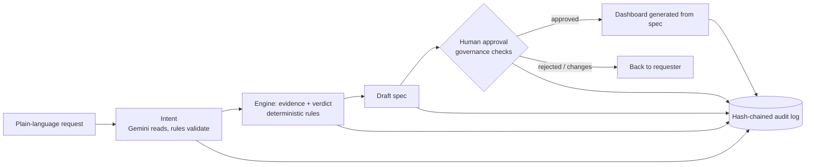

# Analytics Dashboard Factory

**Build less, build better.** An AI agent that turns a plain-language analytics request into a *governed decision*: reuse, extend, consolidate, migrate, retire or build new. Every decision comes with cited evidence, a draft spec, a human approval and a tamper-evident audit log.

Built by Sami and Jessica for the Since AI Hackathon 2026, Bayer challenge **"Build Less, Build Better: AI for Governed Analytics"**.

## The problem

Traditional BI is slow, tedious and error-prone. Someone asks for a dashboard, someone builds it, and the estate keeps growing: duplicates, conflicting KPI definitions, and assets nobody owns or opens. An AI that generates dashboards faster only adds more clutter.

## What it does

1. **Ask** in plain words, in any business domain (not only manufacturing).
2. **Clarify.** The factory repeats back what it understood and asks when something is unclear or unknown. It never guesses.
3. **Evidence.** It checks the existing estate (360 assets, 56 KPI definitions, usage, owners, lineage, governance signals) and ranks candidates.
4. **Recommend.** REUSE, EXTEND, CONSOLIDATE, MIGRATE, RETIRE or NEW BUILD, with the reason and the governance rules applied.
5. **Preview.** A draft spec an approver can read before anything is built.
6. **Approve.** A named, active owner decides. Four-eyes rule, an accountable owner for every approval, a reason for rejections.
7. **Dashboard.** Only after approval is a dashboard generated from the spec, with provenance: who approved it, who owns it, and the approval hash. A comparison of several products, markets or platforms is shown side by side, one tile each, not added into one number, plus one chart that draws them together in different colours (with an indexed view that starts every line at 100).

Every step is written to a hash-chained audit log.



## Try it: every verdict, plus two edge cases

Paste these into the box on `/pipeline` (they are also in `demo-prompts.md`).

| Request | Verdict |
|---|---|
| Can we have a new dashboard for net sales and forecast variance for Kerendia? | EXTEND |
| Compare the sales of Kerendia, Xarelto and Beyonttra | EXTEND, shown side by side: one tile per product, derived from the one dashboard that covers only Xarelto |
| Reimbursement status coverage and market access coverage for Nubeqa in France | REUSE |
| What should we do with the Tableau workbook AST-0183? | CONSOLIDATE (a proposal only) |
| Replace the legacy Tableau Kerendia workbook | RETIRE |
| Please create a Power BI replacement for our legacy Tableau Xarelto commercial workbook. | MIGRATE |
| Show on-time in full, inventory coverage and units shipped for all Pharma, plus the routes at red supply risk | NEW BUILD that rebuilds the home page in the factory's Overview layout: eight tiles with the same numbers as `/` (81.6%, 6.3 weeks, 5.23M units, 28 of 87 routes red, the same four worst routes) |
| Compare Tableau and Power BI report views and exports | NEW BUILD with a working dashboard: not a governed KPI yet, but the pack holds the data, so every tile is marked "not governed" |
| Build a dashboard for employee attrition and headcount by department | NEW BUILD with honest "no data in the pack" tiles (the pack has no HR data) |
| Net sales for Zentrafil in Atlantis (fictional product and place, on purpose) | NEW BUILD plus a question, approval blocked |

## Why you can trust the output (repeatable quality)

- **Rules decide, the LLM only reads.** Verdicts come from a deterministic engine over the data pack, so the same request always gets the same answer, and every verdict cites its evidence and the rules behind it (RULE-001 to RULE-008). Gemini only extracts the intent from the request; its output is validated against the estate and anything it invents is dropped. If Gemini is unavailable, a rule-based parser takes over, so the demo never dies.
- **Governance is code, not prompt.** Only active owners can approve, requesters cannot approve their own request, open questions block approval, every approval needs an accountable owner, and the audit log detects tampering.
- **We measure it.** `python -m engine.evaluate` runs 32 hand-written scenarios across Finance, Market Access, Supply chain, Marketing, Quality, legacy migration and out-of-scope domains (HR, R&D). They include typos, empty input, gibberish and injection-style text. It also checks governance invariants on all 150 synthetic business requests. Current result: **32/32 scenarios, 150/150 invariants, 323/323 flow checks** (the flow checks cover ownership, contacts, data provenance, the audit trace and the open-questions gate). Writing it found and fixed real engine bugs.

## Data assumptions: what is real and what is simulated

- **Real:** the engine, the rules, the verdicts, the approval and audit flow, and the structure and ownership of generated dashboards.
- **Synthetic:** all estate and KPI data comes from the synthetic Since AI Builder Data Pack (not Bayer data), stored in `engine/data/bayer_pack.xlsx`.
- **Pre-existing vs built at the event:** the data pack was provided by the organisers (Since AI) and existed before the hackathon. Everything else in this repository (the engine, the rules, the pages, the evaluation) was built during the event, using open-source libraries.
- **No invented numbers.** Generated dashboard tiles use only values from the pack:
  - Governed KPIs with pack data get a chart (net sales, units shipped, forecast variance, market access coverage, OTIF, inventory coverage, plus derived growth, forecast accuracy, bias and report adoption).
  - A measure that is not a governed KPI but has pack data (forecast value, report views, query errors) is shown and marked *not governed*.
  - A KPI or measure with no data in the pack (for example employee attrition: the pack has no HR data) gets an honest "no data in the pack" tile that says why, never a made-up number.
- **Home page example.** The home page at `/` ("Supply operations overview") is a reference view of a finished supply dashboard, built directly from the pack (not by the factory). It shows which product-market routes are at red supply risk this month. It is built from the same data pack (`Product_Market_Monthly` for values and trends, `Supply_Operations` for risk status). Status levels come from the pack's own risk status, with no invented thresholds and no separate dataset. The factory can rebuild it from a prompt (see the Try it table): the numbers match exactly, and generated dashboards open in a similar calm Overview layout (compact tiles, bars by product, the most urgent routes), with Charts and Table views one click away.

## AI approach

- **Intent extraction (Gemini, Google AI Studio):** maps free text onto products, markets and canonical KPIs. Output is validated against the estate, and anything unknown becomes a question instead of a guess. A model fallback chain and a circuit breaker handle overload.
- **Recommendation (no LLM):** scores each existing asset on relevance (KPI coverage, product, market), trust (endorsement, active owner, healthy refresh, no open signals), adoption and lifecycle, then picks a verdict and cites evidence. Thresholds: trust 0.5, reuse fit 0.6.
- **Explanation:** headline, evidence rows and next actions are generated from the cited facts.

## Governance controls

| Control | How it is enforced |
|---|---|
| Reuse before build (RULE-001) | Existing assets are ranked before any new build is suggested |
| Canonical KPI first (RULE-002) | Non-canonical or conflicting KPI variants are flagged; unknown measures need a definition |
| Owner required (RULE-003) | Only active owners can decide; every approval needs a named accountable owner |
| Lineage required (RULE-004) | Upstream models and downstream impact are shown as evidence |
| High reach requires trust (RULE-005) | Untrusted assets are never recommended for reuse |
| Do not migrate waste (RULE-006) | Legacy workbooks go to CONSOLIDATE, MIGRATE or RETIRE per the migration backlog |
| Explain every action (RULE-008) | Every verdict cites metadata, usage, KPI, lineage and governance evidence |
| Four-eyes and audit | The requester cannot approve their own request; every event is hash-chained and verified |

**Non-destructive by default:** extend derives a new dashboard and leaves the original untouched; consolidation only proposes, and only within one product and one market (different teams and locations need different dashboards); retire and migrate need the owner's agreement, and the old asset keeps running until its users have moved. The factory never edits, merges or retires an asset it does not own: it derives, proposes and asks.

## Accountability and lifecycle

The risk we designed against: a decision is made from a dashboard, a defective product reaches the market, and the investigation asks *who built this, and who approved it?* Self-service BI makes building easy, but the result often has no owner and no lifecycle.

| Question | What the factory does today |
|---|---|
| Who built it and who approved it? | The generated dashboard shows who asked, who approved, when, and the approval hash, with a decision trail below it (see "Decision trail") |
| Who is accountable for decisions made from it? | A named, active accountable owner is required before any decision is approved; the requester cannot approve their own request |
| Who do I ask if it looks wrong or breaks? | The page lists contacts (accountable owner, data model owner, asset owner, KPI owners) read from the data pack every time it opens. A person who is no longer active is flagged, and so are a failed data refresh and open governance signals |
| Can the record be quietly changed? | No: every event is in a hash-chained audit log, and an edit breaks the chain |
| Does the estate grow forever? | No: RETIRE and CONSOLIDATE recommendations propose archiving or merging, with the owners' agreement, and an approved retirement names the asset to archive |
| What is the lifecycle after launch? | Each approved dashboard has a review date, a use check against the estate, a low-use retire signal, and a "Needs review" list ordered by what needs attention |
| Can an investigator see everything in one place? | Yes: the trace page shows the request, the evidence shown, the approval, the current owners and the audit chain |

Honest limits: the 3-month review period and the low-use cutoff (bottom quartile of the estate) are our assumptions, not Bayer policy; the owner emails are synthetic; and we do not claim a pager or an escalation system, because an on-call process is a deployment decision for the BI team.

## For IT: low-friction adoption

IT has to approve and run this, so we designed for a small risk of switching it on and no extra work for them.

**Built today**

| What IT worries about | What the factory does |
|---|---|
| "Will it change my BI platform?" | Advisory first: it reads metadata and recommends. It never writes to Power BI or Tableau, and nothing is published without a named owner's approval |
| "What data leaves the building?" | No business data. The engine works on asset, KPI and owner metadata. The optional Gemini step sees only the request text and the list of allowed product, market and KPI names. The request text does go to Google, and without a key the rule-based parser works with no external call |
| "Can I understand and test it?" | Verdicts are rules, not model opinions, and each cites its evidence. `python -m engine.evaluate` is the regression check (32 scenarios, 150 invariants, 323 flow checks) to run after changing a rule |
| "Is it heavy to run?" | One Python process, no database, no front-end build |
| "Who decides, and can I prove it later?" | Named owners decide, the requester cannot approve their own request, and the audit log is hash-chained. Download it as JSON or CSV (pipeline and trace pages) for a SIEM or an auditor |
| "What is waiting for me?" | The pipeline page lists requests waiting for approval and approved dashboards that need review, most urgent first |

**Roadmap, not built yet** (said plainly so nobody assumes otherwise): single sign-on, so the approver is the signed-in user instead of a name picked from a list; the named accountable owner confirming that they accept the role; approvals inside Teams, ServiceNow or email with a link back; thresholds and the review period in a policy file IT edits, with changes visible in git; exporting the spec as a Power BI project so IT reviews a diff instead of clicking; a private or self-hosted model option; a health endpoint and estate-health counts (ownerless, stale, duplicate assets); per-department home pages and request templates, since each function has its own KPIs, all on one governance layer.

## Enterprise BI integration (in production)

- **Where it lives:** in front of the BI platform (Power BI or Tableau). New assets are published to the governed catalogue only after approval.
- **Ownership:** every asset needs an accountable owner. The requester is not automatically the owner; a named business owner is accountable and a steward certifies.
- **Access:** inherits platform permissions. The audit log records who asked, who approved and what evidence was shown.
- **Lifecycle:** retire and consolidate recommendations feed ongoing clean-up, so the estate shrinks instead of growing.
- **Next steps:** a real feedback loop with users to tune thresholds, binding specs to the governed semantic model, and SSO for approvers.

## Run it

```bash
uv venv .venv --python 3.12
uv pip install --python .venv/bin/python -r requirements.txt
cp .env.example .env          # optional: add GEMINI_API_KEY. Works without it, with rule-based parsing
.venv/bin/uvicorn engine.serve:app --port 8000
```

Then open:

| Page | What it is |
|---|---|
| http://localhost:8000/pipeline | The factory: ask, clarify, evidence, recommend, preview, approve, audit |
| http://localhost:8000/dashboard/{proposal_id} | A dashboard generated from an approved spec (linked from the approve step), with contacts, warnings and lifecycle |
| http://localhost:8000/trace/{proposal_id} | The investigator's view: request, evidence, approval, owners and audit chain in one page |
| http://localhost:8000/ | Supply operations overview: which routes need attention this month, from the data pack |

Run the quality check with `.venv/bin/python -m engine.evaluate`. No `uv`? `python3 -m venv .venv && .venv/bin/pip install -r requirements.txt` works too.

The audit log is saved per machine in `engine/runtime/` (git-ignored). Delete that folder for a clean start.

## Project layout

```
engine/   data loader, recommendation engine, Gemini wrapper, governance and audit log, API routes
app/      FastAPI app: the four page routes (engine/serve.py adds all the API routes, including /api/home)
static/   the four front-end pages (plain HTML, CSS and JS, no build step)
```

## Stack

Python 3.12, FastAPI, pandas, Gemini (Google AI Studio) with a model fallback chain and circuit breaker, plain HTML/JS front end with Chart.js.

Built with Claude Code and Gemini: Claude Code helped write the code, and Gemini (Google AI Studio) reads the request at run time. Verdicts come from rules, not from either model.

## Design

The look is our own palette and layout, inspired by the Bayer brand (blue-to-green gradients, a crimson accent, bold italic headings, Figtree as a free stand-in for Bayer Sans). These are not official Bayer colours, fonts or assets, and the Bayer logo is not used.

## Known limits

- Thresholds (trust 0.5, reuse fit 0.6) are judgement calls and are not tuned on real users.
- The synthetic pack has only 10 distinct request templates, so the evaluation adds hand-written scenarios.
- The pack contains all-zero rows for product-market pairs that are not sold; these are ignored in averages.
- Unknown-name detection is a heuristic.
- The data pack has no KPI measurements for some governed KPIs and no HR data, so those tiles show an honest "no data" message.
